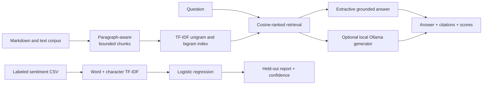

# RAG and NLP Systems

[](https://github.com/cjf-iii/rag-nlp-systems/actions/workflows/tests.yml)


Two local-first, inspectable NLP systems: grounded document retrieval with citations and supervised sentiment classification with held-out evaluation.

> Resume claim: Built RAG agents and NLP pipelines from first principles for document retrieval, text analysis, and sentiment classification.

## Review it

```bash
uv sync --locked
uv run python -m unittest discover -s tests -v

uv run rag-nlp index --corpus data/knowledge --output artifacts/knowledge.joblib
uv run rag-nlp ask \
  --index artifacts/knowledge.joblib \
  --question "How does batching affect inference capacity?"

uv run rag-nlp sentiment-train \
  --data data/sentiment.csv \
  --output artifacts/sentiment.joblib
uv run rag-nlp sentiment-predict \
  --model artifacts/sentiment.joblib \
  --text "The benchmark was clear and reproducible"

uv run python scripts/verify_artifacts.py
```

The project uses `uv` exclusively. `.python-version` pins Python 3.12 and `uv.lock` pins the complete environment. The default path is offline and cross-platform.

## Executable reviewer notebook

[Open the raw-data-to-validation tutorial](notebooks/01_data_to_validation.ipynb), or launch it from the repository root:

```bash
uv sync --locked --group notebook
uv run --group notebook jupyter lab notebooks/01_data_to_validation.ipynb
```

The notebook deliberately corrupts the labeled CSV, proves exact cleanup, evaluates and persists the sentiment model, builds and reloads the retrieval index, answers the documented question with citations, and runs the repository tests. CI executes every cell without modifying the committed notebook.

## System design



### Retrieval and RAG

- recursively ingests UTF-8 Markdown and text files in stable path order;
- uses paragraph-aware splitting and hard bounds over long paragraphs;
- ranks chunks with cosine similarity over TF-IDF features;
- selects relevant source sentences for the default offline answer;
- returns the answer, ranked retrieval scores, chunk identifiers, and source citations;
- returns an explicit insufficient-context response when no indexed term matches.

The optional Ollama adapter sends the retrieved context to a user-selected model on the configured endpoint. It is not needed to reproduce the résumé claim or pass the release gate.

### Sentiment NLP

- combines word n-grams and character n-grams;
- trains a seeded, class-balanced logistic-regression classifier;
- reports a stratified held-out evaluation without fitting on test rows;
- persists the fitted pipeline and returns labels, confidence, and per-class probabilities.

The included labeled examples are deliberately small demonstration data. Their score proves that the pipeline executes; it is not evidence of production sentiment accuracy.

## Repository map

```text
.
├── .github/workflows/tests.yml  # public Ubuntu release gate
├── data/
│   ├── knowledge/               # original demonstration corpus
│   └── sentiment.csv            # labeled demonstration examples
├── notebooks/01_data_to_validation.ipynb
├── scripts/verify_artifacts.py
├── src/rag_nlp_systems/
│   ├── cli.py
│   ├── rag.py
│   └── sentiment.py
├── tests/
├── MODEL_CARD.md
├── pyproject.toml
└── uv.lock
```

## Optional local generation

If Ollama is already installed and a suitable local model is available:

```bash
ollama pull qwen2.5:1.5b
uv run rag-nlp ask \
  --index artifacts/knowledge.joblib \
  --question "What is the latency-throughput tradeoff?" \
  --provider ollama \
  --model qwen2.5:1.5b
```

The model and its hardware requirements belong to that optional runtime, not to the default TF-IDF implementation.

## Evidence and boundaries

- This is a working portfolio system, not a claim of customer deployment or foundation-model training.
- TF-IDF retrieves lexical similarity rather than general semantic equivalence.
- Extractive answers remain bounded by retrieval quality; citations expose the evidence for review.
- Joblib artifacts use pickle-compatible serialization. Load only files created locally or obtained from a trusted source.
- The public workflow installs from `uv.lock`, checks Ruff, runs the test suite, executes both documented CLI paths, reloads both saved artifacts, and validates the expected outputs.

See [MODEL_CARD.md](MODEL_CARD.md) for limitations and [VERIFICATION.md](VERIFICATION.md) for the recorded release evidence.

## License

[MIT](LICENSE)
